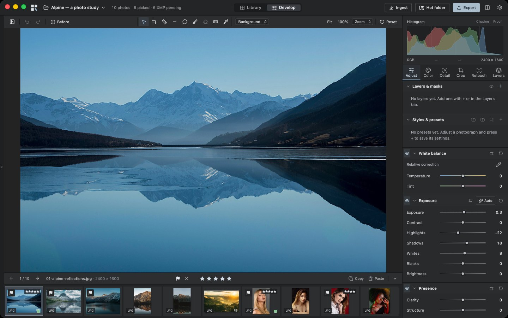
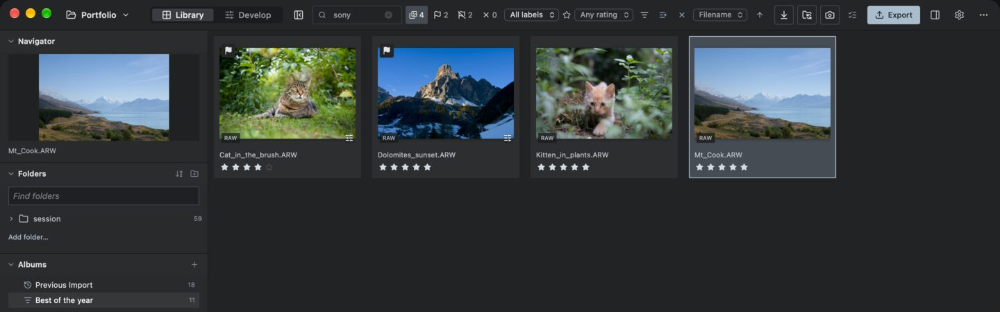
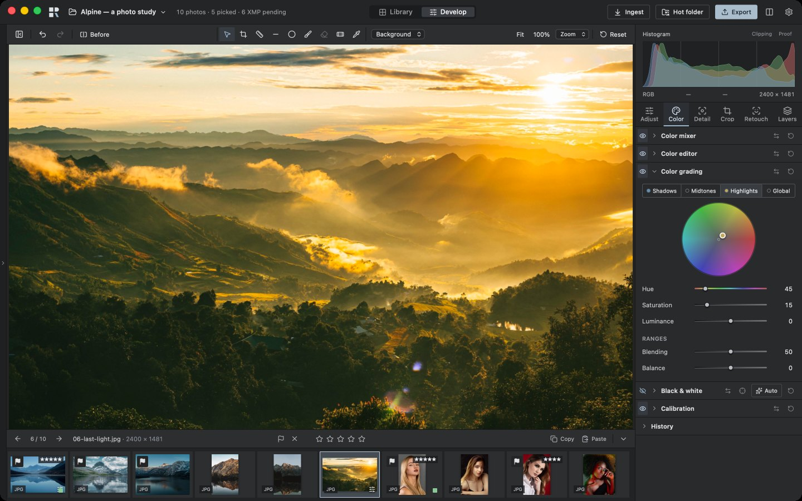
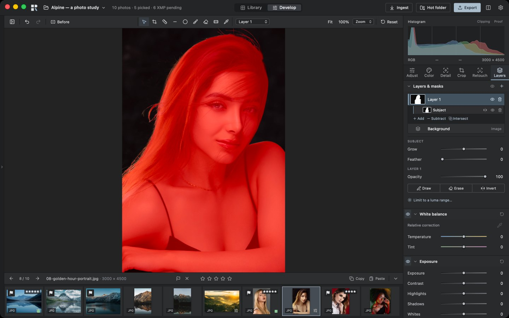
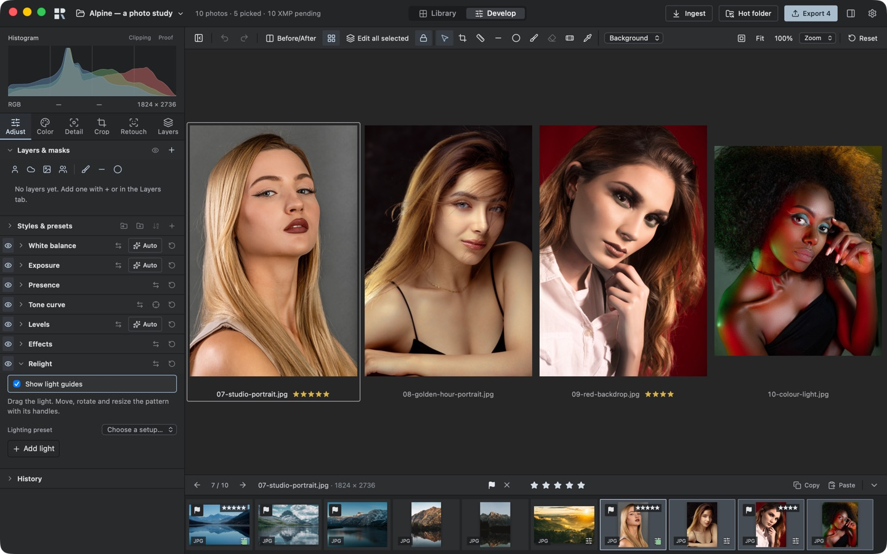
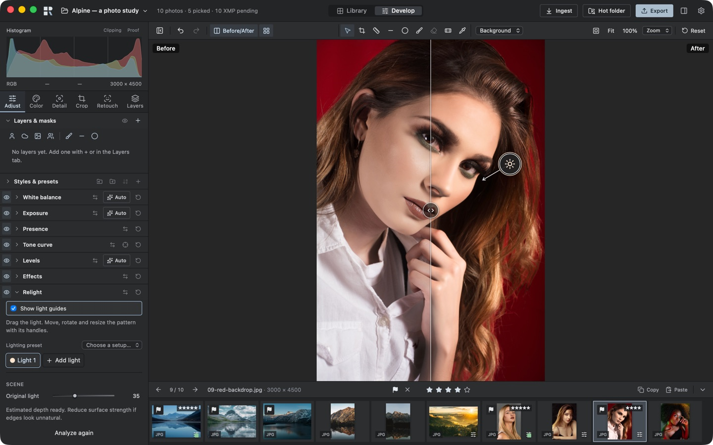
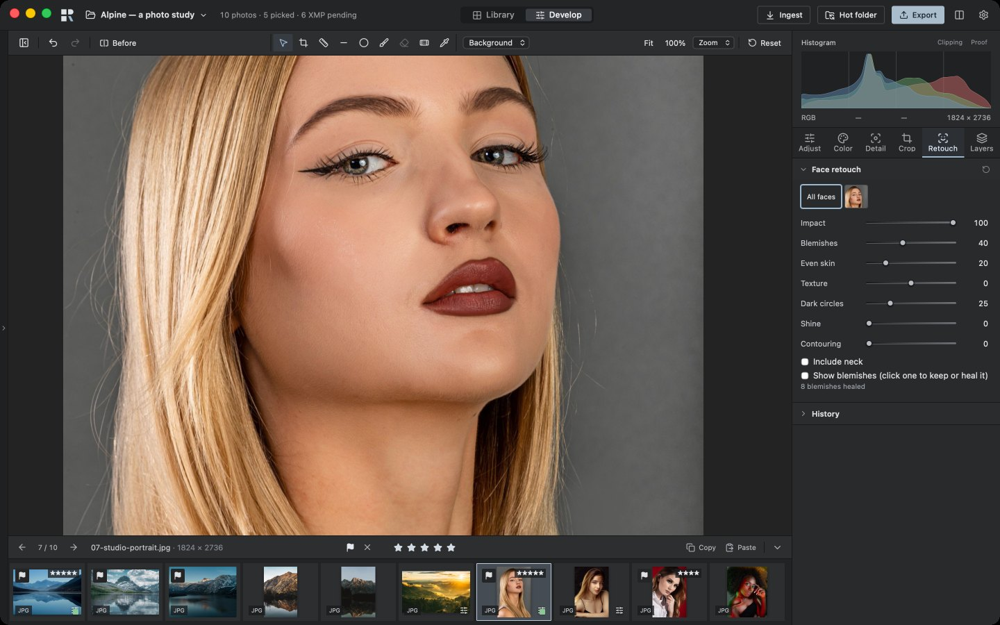
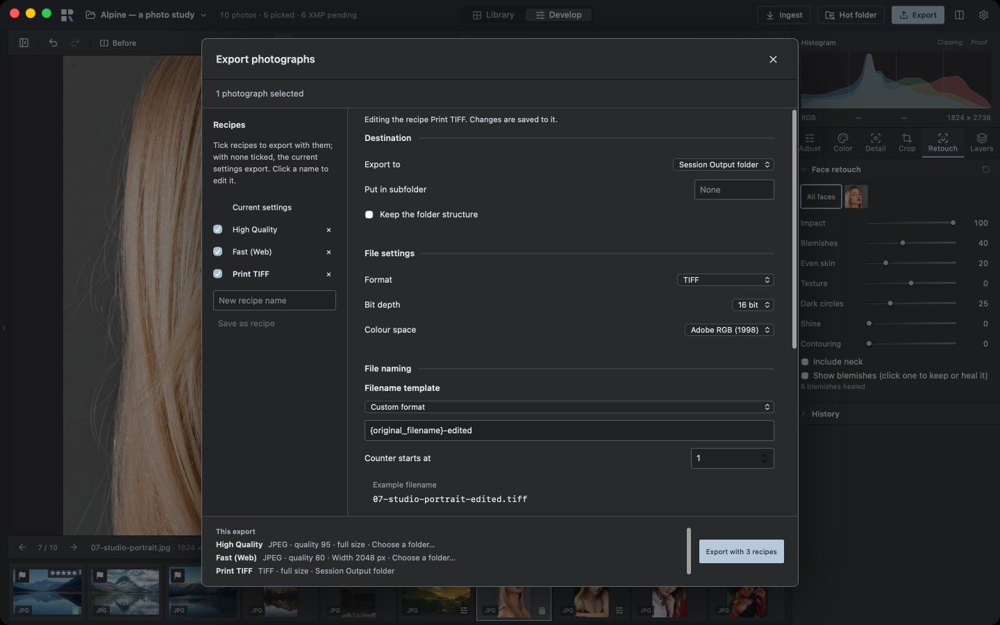

<p align="center">
  <picture>
    <source media="(prefers-color-scheme: dark)" srcset="docs/brand/rawtonic-horizontal-colour-on-dark.svg">
    
  </picture>
</p>

<p align="center">
  A free, open-source <b>RAW developer</b> for photographers.<br>
  <b>Ingest → select → develop → retouch → deliver</b>, on your own Mac or Linux PC, with your originals left untouched.
</p>

<p align="center">
  <a href="https://github.com/rawtonic-app/rawtonic/releases"></a>
  
  
  
</p>

<p align="center">
  <a href="#download"><b>Download</b></a> ·
  <a href="#from-card-to-client">Workflow</a> ·
  <a href="#what-it-does">Features</a> ·
  <a href="#keyboard">Keyboard</a> ·
  <a href="#bug-reports--feedback">Feedback</a> ·
  <a href="#license">License</a>
</p>

<p align="center">
  <a href="docs/images/readme-develop.jpg">
    
  </a>
</p>

> [!WARNING]
> **Rawtonic is an early alpha.** It is usable for real work, but features are still missing and you will run into bugs. Keep your originals backed up, as with any new software. Rawtonic never changes your RAW files: edits live beside them, in a project database and XMP sidecars.

## About

Most serious RAW software now comes with a subscription, a cloud account or both, and the free alternatives are capable but rarely feel at home in a paid shoot. I wanted a RAW developer that holds its own against the big professional editors in image quality, speed and workflow, and that I own outright. So I am building one, and sharing it.

Rawtonic is a one-person project that I work on in my spare time. Some weeks a lot happens, and sometimes it takes a while until the next release or a bug fix. Thanks for your patience, and for every bug report: they decide what gets fixed first.

## Download

Get the latest build from the [**Releases**](https://github.com/rawtonic-app/rawtonic/releases) page.

Rawtonic runs on **macOS** (Apple Silicon; Intel experimental), **Linux** (x86-64) and, experimentally, **Windows** (x64).

### macOS

Download `Rawtonic_<version>_aarch64.dmg` for Apple Silicon (M1 and later), macOS 13 or later. Open it and drag **Rawtonic** to **Applications**. The app is signed with an Apple Developer ID and notarized by Apple, so it opens with a double-click.

For Intel Macs there is an experimental `Rawtonic_<version>_x86_64.dmg`. So far it has run only under Rosetta 2 on Apple Silicon, not on an Intel Mac; please [report](https://github.com/rawtonic-app/rawtonic/issues) how it runs on yours.

### Linux

Download `Rawtonic_<version>_amd64.AppImage` for x86-64, make it executable and start it:

```sh
chmod +x Rawtonic_*_amd64.AppImage
./Rawtonic_*_amd64.AppImage
```

It runs on current distributions (Ubuntu 22.04 or later, Debian 12, Fedora and others with glibc 2.35 or later). If it does not start, install FUSE 2 (`sudo apt install libfuse2t64` on Ubuntu 24.04, `libfuse2` on older Ubuntu and Debian) or start it with `--appimage-extract-and-run`. The very first start can take a minute or two before the first photo appears while the graphics driver prepares Rawtonic's shaders; later starts are quick.

To update, use [AppImageUpdate](https://github.com/AppImageCommunity/AppImageUpdate) or [Gear Lever](https://flathub.org/apps/it.mijorus.gearlever): the AppImage names its GitHub releases as its update source, and they download only the changed parts. Rawtonic checks for new releases at startup at most once per day; you can turn this off in Preferences. It never downloads or installs updates itself.

### Windows (experimental)

Windows installer downloads are not attached to a release yet. When available, use `Rawtonic_<version>_x64-setup.exe` and `SHA256SUMS-windows.txt` for Windows 10 or 11 (x64; so far tested on Windows 11). The installer is **not signed** yet. To check download integrity before running it: in PowerShell, `Get-FileHash .\Rawtonic_*_x64-setup.exe` must print the same SHA-256 as `SHA256SUMS-windows.txt` (upper- or lower-case does not matter). This catches download corruption; it does not verify the publisher. When you start it, Windows SmartScreen shows "Windows protected your PC": click **More info**, then **Run anyway**. It installs for your user only, without administrator rights; uninstall it in Settings → Apps.

Installing takes about a minute: at the end the installer prepares Rawtonic's GPU shaders, so the first photo appears sooner on the first start. Rawtonic needs a GPU with a Vulkan or DirectX 12 driver; PCs with only Microsoft's software renderer are not supported yet. Windows support is new and has so far been tested with one NVIDIA graphics card, so please [report](https://github.com/rawtonic-app/rawtonic/issues) how it runs on yours.

### Other systems

Other systems are not supported yet; you can try to [build from source](docs/DEVELOPMENT.md).

## From card to client

### 1 · Bring the shoot in

Start a **project** for a portrait sitting, a wedding or a product shoot. **Ingest** copies the photographs from the card, checks every copy against the original before it counts as safe, and can write a backup to a second drive at the same time. The card is never changed. You can also drag photographs from the Finder or your file manager straight onto the window. Shooting tethered into a folder? **Hot folder** picks up each new file as it arrives (optionally from subfolders too) and can apply a preset or the previous photo's settings, a rating and keywords straight away; it keeps watching when you reopen the project, and picks up what arrived while Rawtonic was closed.

Use a **catalog** for a growing photo collection. Imports copy into its own `Photos/year/date` folders by default; you can also keep photos in their existing folders. Albums organize photographs without moving them. Moved, renamed, added or deleted files outside Rawtonic? **Synchronize Folder** finds the changes, follows moved photos with their edits and lets you review everything before it is applied. The library menu can create a **portable copy** for another computer, make a **full verified backup**, or **restore a backup** into a new folder—including external originals and required edit resources.

Already have a Lightroom Classic catalog or a Capture One session? Rawtonic can import it, with ratings, labels, keywords, albums and translated edits.

### 2 · Find the keepers

<p align="center">
  <a href="docs/images/readme-library.jpg"></a>
</p>

The **Library** shows the whole shoot. Rate with 1–5, pick and reject with P and X, add colour labels, then filter down to the frames that matter. Press E or Space to see a photograph large in the **loupe**, with its keywords and metadata beside it; G goes back to the grid. A double-click (or D) opens it in Develop. Group keepers into albums and add keywords, captions and copyright while you are at it. Everything is written to standard XMP sidecars, so other software sees your ratings too.

### 3 · Develop

The **Develop** room gives the photograph the space: a filmstrip, a histogram and compact tool tabs. Work from the overall light and colour down to the details, compare with **Before/After** (Y), line up a series side by side in the **multi view** (N) and edit them all at once, see the photograph alone in **full screen** (F, also from the Library; I shows its facts), step back through **History**, copy settings across a series and save your own presets. Drag a slider to explore or type a number to be exact.

<table>
<tr>
<td width="50%" valign="top">
<a href="docs/images/readme-color.jpg"></a>
<br><b>Colour.</b> White balance from the RAW, a colour editor, colour grading for shadows, midtones and highlights, black-and-white mixing and your own camera profiles or LUTs.
</td>
<td width="50%" valign="top">
<a href="docs/images/readme-masks.jpg"></a>
<br><b>Local adjustments.</b> Brush, linear and radial masks, colour and luminance ranges, and one-click masks for the subject, sky, background, depth or people.
</td>
</tr>
<tr>
<td width="50%" valign="top">
<a href="docs/images/readme-multiview.jpg"></a>
<br><b>Multi view.</b> Compare up to twelve selected photographs side by side, with a reference photo and a locked zoom, and edit them all at once.
</td>
<td width="50%" valign="top">
<a href="docs/images/readme-relight.jpg"></a>
<br><b>Relight</b> <i>(experimental)</i>. Light a photograph again after the shoot. Before/after split: on the left the original warm light, on the right a new cool light from the other side with the original turned down.
</td>
</tr>
</table>

### 4 · Retouch and merge

<p align="center">
  <a href="docs/images/readme-retouch.jpg"></a>
</p>

**Portrait retouch.** Rawtonic finds the faces and heals blemishes, evens out skin, softens dark circles and shine, each with one slider, for everyone in the photo or one person at a time, and keeps the skin's texture. Heal, clone and remove distractions by hand where you need to.

**Relight** _(experimental)_. Add up to four lights to a photograph after the fact. Rawtonic estimates the depth, the people's surfaces and the photo's own lighting, so a new light brightens a face's shadow side, the original light can be turned down and the subject casts its shadow on the background.

**Merge.** Combine brackets into an HDR, stitch panoramas (also from brackets), or focus-stack a macro series. The result is a new RAW (DNG) that you develop like any other photograph.

### 5 · Deliver

<p align="center">
  <a href="docs/images/readme-export.jpg"></a>
</p>

Save **export recipes** for full-size delivery, web sizes, social media or TIFFs for retouching, and tick several to produce every version in one go, each with its own size, format, colour space, sharpening, watermark and folder. The **export queue** survives a restart: resume an interrupted job and retry failed photographs when you are ready.

## What it does

- **Originals stay yours.** Your RAW files are never modified or deleted. Ingest verifies every copy; edits live in a portable project and XMP sidecars.
- **Fast, on the graphics card.** The photograph is rendered on the GPU (on a Mac natively beneath the interface), so sliders, brushes and masks respond while you drag.
- **Light.** Exposure, highlights, shadows, whites and blacks, levels, point and region curves, clarity, structure, dehaze.
- **Colour.** RAW white balance, colour editor, colour grading, vibrance, black-and-white mix, camera profiles, CUBE LUTs, soft proofing for print and web colour spaces.
- **Detail.** Sharpening, noise reduction, AI Denoise\*, chromatic aberration removal and defringing.
- **Local adjustments.** Brush, linear and radial masks, colour and luminance ranges, subject, sky, background, depth and people masks\* (skin, hair, eyes, lips, clothes …), layer opacity.
- **Geometry.** Crop, straighten, automatic and guided perspective correction, automatic lens corrections.
- **Retouch.** Heal and clone with spots or brush strokes, object removal\*, automatic face retouch\*.
- **Relight\*** _(experimental)_. Up to four added lights with patterns; the photo's own light can be turned down.
- **Merge.** HDR, panorama, HDR panorama and focus stacking to a DNG; collages.
- **Film.** Convert scanned negatives; grain with five structures (even, soft, clumped, speckled, gritty) and vignette.
- **Output.** JPEG, TIFF, PNG, WebP, JPEG XL and AVIF in sRGB, Display P3, Adobe RGB or ProPhoto RGB; output sharpening for screen and print; watermarks and borders; metadata you choose to keep.
- **Private by design.** No account or telemetry. An optional startup update check is the only automatic network access ([privacy](PRIVACY.md)).

<sub>\* Optional AI tools. They run on your computer, never in the cloud; each model is downloaded once, the first time you use the tool (see <a href="docs/MODELS.md">AI models</a>). Areas filled by a generative model are marked as such in exported files.</sub>

## Keyboard

| Keys                         | Action                         |
| :--------------------------- | :----------------------------- |
| **G** / **E** / **D**        | grid / loupe / Develop         |
| ← / →                        | previous / next photograph     |
| **1**–**5** / **0**          | star rating / clear it         |
| **P** / **X** / **U**       | pick / reject / clear the flag (⇧X also rejects) |
| **6**–**9**                  | red / yellow / green / blue label |
| **Caps Lock**                | auto-advance (also in the Photo menu) |
| **Y**                        | toggle before / after split    |
| **⇧Y**                       | cycle Off / left-right / top-bottom |
| hold **\\**                  | whole photograph before        |
| **N**                        | multi view of the selection    |
| **F**                        | photograph alone, full screen  |
| **I** (Develop, full screen) | photograph info                |
| ⌃⌘F (macOS) / **F11**        | window full screen             |
| **⇧Return** / **⌘Return**    | pin / clear the reference      |
| **C** / **R** / **B**        | crop / straighten / brush      |
| **M**                        | show or hide the mask overlay  |
| **J**                        | clipping warnings              |
| **Alt+X**                    | proof margin                   |
| **Tab** (on the photograph)  | hide or show the panels        |
| ⌘Z / ⇧⌘Z                     | undo / redo                    |

The before / after button’s menu (chevron or right-click) chooses Off, Split left-right or Split top-bottom. The divider follows a drag or the arrow keys along its axis (Shift for a larger step), Home/End moves to an edge, and double-click centres it. The choice and divider position are remembered per project or catalog, while zoom and pan stay in place when switching modes.

The before / after split shows in the single view only: turning on the multi view turns the split off, and turning on the split leaves the multi view.

On Linux, **Ctrl** takes the place of **⌘** (Ctrl+Z, Ctrl+Return …). The keys follow what photographers already know from the big editors, and every shortcut can be changed in Settings.

## Status and known limitations

Rawtonic's goal is simple to state and hard to reach: every tool should be at least as good as the better of the leading professional editors, measured on real photographs. Some tools are there, others are not yet. In this alpha:

- **macOS on Apple Silicon and Linux (x86-64 AppImage); Windows experimental.** The Intel Mac build is experimental (not yet run on Intel hardware), and so is the unsigned Windows installer (so far tested with one NVIDIA graphics card). On Linux, Develop shows its preview through the web view rather than directly on the GPU, so it is not quite as immediate as on a Mac, and it has been tested on fewer systems (NVIDIA on KDE Wayland; exports also on Ubuntu, Debian and Fedora).
- **Cameras.** The focus is on professional and popular cameras and phones of the last ten years (Canon, Nikon, Sony, Fujifilm, Panasonic, OM System/Olympus, Leica, DJI, iPhone ProRAW and other DNGs). Older or rarer cameras may open with less accurate colour, or not at all. Nikon _High Efficiency_ NEFs are not supported yet; use lossless compressed RAW for now.
- **Importing from Lightroom or Capture One** brings over metadata, albums and most edits, but not everything: some adjustments, virtual copies and smart collections don't transfer, and photos can look different.
- **Batch export is still slower than Lightroom and Capture One.** A set of 20 Nikon Z RAWs (38 web JPEG and 16-bit print TIFF outputs; one unsupported RAW) took about 14 s in a headless Rawtonic run on a Mac mini M4 Pro, versus Lightroom’s 8 s and Capture One’s 9 s on an M5 Pro laptop. These were not measured on the same machine; the [alpha.4 same-machine comparison](CHANGELOG.md#010-alpha4--2026-10-24) was about 17 s versus 8/9 s, and has not been repeated. Across successive A/B measurements since alpha.4, app export time on a separate 27-RAW batch on the Mac mini fell by about 40 % (about 41 s to 25 s).[^batch-export]
- **Relight is experimental.** The original light's own cast shadows stay in the photo, and the subject's shadow on the background does not touch the ground.
- **Tethering is experimental.** The Tether tool (session bar) connects a camera on USB through libgphoto2 in a separate helper process, fires it, shows its settings and live view and copies each photo into Capture. It has been tested on a Mac with a Sony a7 III and a7 IV and a Fujifilm X-H2S and GFX 50R (capture, settings, focus, cable pulled and plugged in again, long series); Fujifilm live view does not work yet, the GFX 50R shows a new photo a little later than Capture One, Canon cameras are not supported yet, and other cameras and Linux have not been tried with a body. The tether panel's **Camera test** checks a camera step by step and makes an anonymous report you can send in one click (after seeing exactly what is sent) or paste into a camera report; tested and reported cameras are listed in [docs/TETHER_CAMERAS.md](docs/TETHER_CAMERAS.md). The hot folder works with your camera maker's tethering app.
- Expect rough edges in the interface, missing shortcuts and the occasional crash. Please [report them](#bug-reports--feedback).

[^batch-export]: Measurement basis: October 26, 2026, Mac mini M4 Pro (12 cores, 24 GB), macOS 27, Metal. Headless CLI build `1c8ec78b` (export change merged in [#363](https://github.com/rawtonic-app/rawtonic/pull/363)), warm A/B/B/A runs: 13.87, 14.07, 14.36 and 13.88 s. Each supported RAW produced a 2048 px sRGB JPEG (quality 80, watermark, sharpening) and a full-size 16-bit Adobe RGB TIFF (print sharpening). Lightroom/Capture One’s 8/9 s were measured on the M5 Pro laptop on October 21. The separate app series used 27 mixed RAWs and two recipes while dragging Develop sliders: build `8de96220` took 41.2/41.3 s; successive changes through #363 reached 24.5–25.0 s. This combines successive A/B measurements, not one direct alpha.4-versus-alpha.7 run (see [alpha.6 and alpha.7 release notes](CHANGELOG.md)).

## Bug reports & feedback

Please [**open a GitHub issue**](https://github.com/rawtonic-app/rawtonic/issues/new) for bugs, questions and feature ideas, rather than an e-mail. Issues keep the details, screenshots and follow-ups in one place, other photographers with the same problem can find them, and you are notified when a fix ships.

A useful bug report says which Rawtonic version you run (Settings → About), your system (macOS version and Mac model, or Linux distribution and graphics card), and, for photos that don't open or look wrong, the camera model and file type (for example Sony `.ARW`).

## Support

Rawtonic is free and open source, built in my spare time. If it helps you on a shoot and you would like to keep it going, you can buy me a coffee. Every bit is appreciated. ☕

[](https://ko-fi.com/nielsfranke)

## For developers

Rawtonic is written in Rust (Tauri, wgpu) with a React interface. See the [development guide](docs/DEVELOPMENT.md) to build and run it from source, the [architecture](docs/ARCHITECTURE.md) and [contributing](CONTRIBUTING.md). The `rawtonic` command-line tool creates sessions, ingests, rates and exports with the same renderer as the app.

## License

[GNU AGPL-3.0-or-later](LICENSE). Rawtonic is free software: use, study, modify and share it. If you distribute a modified version, you must release your changes under the same license and make the source available.

Contributions are welcome under a simple [Contributor License Agreement](CLA.md).

Rawtonic's editor started from [RapidRAW](https://github.com/CyberTimon/RapidRAW) by Timon Käch (commit `a82251f`), whose copyright and license notices are kept; see [NOTICE](NOTICE) and [third-party notices](THIRD_PARTY_NOTICES.md). This product includes DNG technology under license by Adobe.

Rawtonic is an independent project and is not affiliated with, endorsed or sponsored by Adobe, Capture One, Fujifilm or any camera maker. Their names are trademarks of their owners and appear only to say what Rawtonic imports from or works with ([trademarks](TRADEMARKS.md)).

Screenshots show demo projects with photographs from pixls.us PlayRaw and Pexels ([photography credits and image licenses](docs/images/CREDITS.md)).
